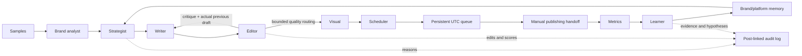

# CreatorOS

Optional [Instagram single-photo publishing](docs/INSTAGRAM_PUBLISHING.md) is now
implemented behind explicit authorization, a disabled-by-default publishing flag
and per-post confirmation. It is mock-tested, not yet verified on a live account;
other platforms and queued handoffs still require manual publishing.

A brand-agnostic, multi-agent content studio with two improvement loops: editor
critique changes the current draft, and performance evidence changes the next brief.
**All live AI calls route through Mesh API** at `https://api.meshapi.ai/v1`.
Brew Lab Coffee is one optional fictional scenario, alongside AI and education examples.

The [bounded self-improvement controller](docs/SELF_IMPROVEMENT.md) now records
accept/refine/restart decisions, revisits a stalled strategy at most once, preserves
the strongest revised candidate, and withholds images for unapproved content.
Its rubric confidence is explicitly uncalibrated; it is not an engagement forecast.

[Self-correcting evidence memory](docs/SELF_CORRECTING_MEMORY.md) checks source
metrics, content and brand versions before reusing lessons. Stale lessons are
withheld, supported API comparisons can be corrected locally, and previous
versions remain auditable. Evidence consistency does not establish causal truth.

[Source-linked evidence](docs/RESEARCH_EVIDENCE.md) includes uploaded brand documents,
product facts, and real performance observations collected from authorized social APIs.
The strategist and writer receive provenance-linked excerpts through Mesh; simulated
and user-entered data stay separate from provider observations.

[The verification loop](docs/VERIFICATION_LOOP.md) checks draft claims against cited sources,
retries retrieval once for thin evidence, and holds unsupported content for review.

[Grounded output](docs/GROUNDED_OUTPUT.md) adds a structured claim-to-source report
with verbatim evidence quotations, source provenance and excerpt hashes. Invented
quotations or missing evidence block approval. Inspect it in Final post or fetch
`GET /posts/{id}/evidence-report`; this export makes no AI or network calls.

[The run audit trail](docs/RUN_AUDIT.md) records product-specific evidence
questions, actual retrieval attempts and every verification verdict with its
reason. Select **Run audit** or use `GET /posts/{id}/audit-trail` to inspect the
chronological history, including failed retrievals and claims rejected before
correction. Viewing/exporting it uses no Mesh credits.

[Brand attachments](docs/BRAND_ATTACHMENTS.md) support text, audio and video
uploads with local playback/download and editable user-supplied transcripts or
notes. Uploading uses no AI credits; only supplied text is used as cited evidence.

[Structured research, source review, exports and follow-ups](docs/STRUCTURED_RESEARCH.md)
are integrated into the live pipeline. An executable custom state graph routes
verification failures back to research once. Provenance weights and quoted source
disagreements are visible in the app. Saved posts have standalone HTML report
downloads and conversations that reuse their source snapshots; evidence browsing
is free and optional Mesh answers are capped at two calls per question.

[Per-agent economical model routing](docs/AGENT_MODELS.md) selects GPT-4.1 mini for
voice/writing/editing, Gemini Flash-Lite for short planning/interpretation/prompting,
and GPT Image Mini for images. A [small live text comparison](docs/MODEL_COMPARISON_075.md)
cost $0.0123379 in total under a combined $0.75 cap; results are provisional and
that comparison did not test media quality. Role environment variables override the optional
global `MESH_TEXT_MODEL` setting.

The subsequent [budgeted end-to-end validation](docs/LIVE_VALIDATION_075.md)
completed for **$0.16066170 total**, including failed attempts, under its $0.75
limit. Two Instagram graph runs passed with source receipts, a Mesh-generated
image, locally rendered video/music, scheduled storage, simulated feedback and
learning applied to the next post. Five other platforms ran writer/editor checks;
live social publishing/read-back was not tested. The selected final editorial
proxy scores average **92.857/100**, with X and Threads still failing some checks.
Successful runs used an explicitly stronger diagnostic model profile; economical
defaults and historical benchmark results are not silently reclassified.

[Saved-brand validation](docs/SAVED_BRAND_VALIDATION_075.md) subsequently exercised
LearnAIwithSachit and Content Tracker AI. Both primary posts passed; the learned
second post passed for LearnAIwithSachit and was held for Content Tracker AI.
The combined cost including the earlier validation is **$0.33967690 / $0.75**.
The report preserves failures and a generated-visual quality issue. Raw customer
samples and copy stay in the local, gitignored validation database.

## Run the real studio with spending locked

Python 3.11+:

```powershell
python -m venv .venv
.venv\Scripts\python -m pip install -r requirements.txt
if (!(Test-Path .env)) { Copy-Item .env.example .env }
.venv\Scripts\python -m uvicorn main:api --host 127.0.0.1 --port 8000
```

Open [the studio](http://127.0.0.1:8000) or [API documentation](http://127.0.0.1:8000/docs).
Linux/macOS: use `.venv/bin/python` and `cp` as appropriate. Existing credentials
should remain in a gitignored `.env`; never copy an example over an existing key.
This checkout also has gitignored `.deps` installed using the bundled Python runtime.

The default `CREATOROS_MODE=live` selects the real Mesh agents. Spending remains
locked until `MESH_ENABLE_PAID=1` is explicitly configured; having a key present
does not enable calls. A locked request fails visibly and never substitutes a stub.

For development only, explicitly set `CREATOROS_MODE=offline`. This uses labeled
deterministic fixtures, scripted scorecards and a vector placeholder with no model
calls. Its sample-cue profiles are not claimed to be AI-learned. Live and offline
modes default to separate databases (`data/creatoros-live.db` and
`data/creatoros-offline.db`). Existing `data/creatoros.db` is preserved; set
`CREATOROS_DB` explicitly if you intend to open it.

## Explicitly enable live AI

After deciding to spend credits, set these in your own local `.env` and restart:

```dotenv
CREATOROS_MODE=live
MESH_ENABLE_PAID=1
MESH_API_KEY=your_local_key
MESH_TEXT_MODEL=openai/gpt-4o
MESH_IMAGE_MODEL=openai/gpt-image-1
```

`Mesh` is the sole provider client. It uses the OpenAI SDK with the Mesh base URL.
The specialist agents have separate prompts, JSON contracts and responsibilities.
There is no fallback to direct OpenAI, another provider, or an unlabeled fake image.
`python check_mesh.py` performs a metadata-only check; that client cannot generate.

Default safeguards:

| Setting | Default |
| --- | --- |
| Paid generation | Locked until `MESH_ENABLE_PAID=1` |
| Automatic SDK transport retries | 0 |
| Extra JSON/schema retries | 0 (`MESH_FORMAT_RETRIES=1` explicitly allows one) |
| Text output limit | 1,200 tokens (`MESH_MAX_OUTPUT_TOKENS`) |
| Calls per gateway operation | 10 (`MESH_MAX_CALLS`) |
| Image calls per generation run | At most one |
| Writer drafts | At most three; at least one changed revision |

These are call/token limits, not currency budgets. A normal two-draft run uses
six text calls and one image call, excluding initial voice extraction and later
learning. The deterministic scheduler needs no LLM call. Usage is displayed from
actual response metadata, never invented for a demo.

## Walk through the studio

1. Add any brand with three or more distinct historical posts of 20+ characters.
   Live mode learns tone, vocabulary, structure, CTA habits and sample evidence.
   Or click an optional offline scenario to load five fictional sample posts and
   clearly labeled historical engagement fixtures. Scenarios are never auto-loaded.
2. Enter a brief and choose LinkedIn, X, or an Instagram carousel. The coordinator
   runs strategist → writer → editor → revised writer → editor → visual → scheduler.
   Instagram outputs include slide text and a separate caption.
3. Follow current progress and the timestamped agent log. Inspect strategy reasons,
   each draft, editor requests, image prompt and actual usage. Use saved-trace playback
   with previous/next/play/reset/latest, 1×/2×, Space, right arrow and R.
4. Inspect **Self-check scores** for all five criteria, the actual changed draft,
   requested edits and complete version history. Below-threshold content remains
   `needs_review` and cannot enter the schedule queue.
5. Review the recommended slot. It cites comparable 24-hour observations where
   available and labels simulated evidence. Without evidence it explicitly proposes
   an unvalidated heuristic. Confirm a future time in your local timezone.
6. The persistent queue marks due content `ready_to_publish` for manual publication.
   Scheduling itself never claims to publish anything.
7. Enter metrics with an observation ID, source and window. The learner stores a
   tentative evidence-linked rule. Run the same brief and platform with and without
   memory to compare saved outputs in **Learning loop**.
8. Inspect other profiles and samples in **Voice switch**. **How it works** shows
   the full selectable architecture and both loops using the selected post's saved trace.

## How the agents cooperate



The six primary responsibilities are strategist, writer, editor, visual director,
scheduler and learner. The brand analyst prepares an additional profile. The writer
also performs rewriting; every revision receives the previous draft and critique.
The editor scores hook, clarity, voice, platform and CTA from 0–10. At least one
changed revision is required, with at most three drafts. Approval requires an average
of at least **9.1/10 in live mode**, no criterion below **8/10**, and valid platform
structure. Local checks feed targeted revisions and block concrete defects or new
style regressions. A third editorial draft can use remaining capacity while
reserving independent verification, within the existing ten-call cap. These are
approval targets, not measured independent benchmark scores. Offline demonstrations
retain explicitly scripted 8/10 routing fixtures. Invalid or unchanged output fails visibly.
The scheduler performs evidence analysis and timezone arithmetic in ordinary code.

See [the screenshot alignment matrix](docs/ARCHITECTURE_ALIGNMENT.md) for a capability-by-capability mapping.

See [capability implementation and validation boundaries](docs/FEATURE_COMPLETENESS.md)
for the executable graph, six native format contracts, linked one-idea adaptations,
Instagram publishing/read-back and performance-to-next-draft tests. Saved posts
offer **Adapt this idea to another platform**: preview the format for free, then
explicitly start one target run. Read connectors for six platforms do not mean
publishing exists for all six; only Instagram single-image publication is implemented.

## Learning, storage and design decisions

- **SQLite persistence:** brands, samples, profile snapshots, drafts, reviews, images,
  posts, metrics, hypotheses and audit events survive restart in the mode-specific SQLite database.
  `CREATOROS_DB` explicitly overrides the path. Posts retain their exact profile version.
- **Explicit coordinator:** a small bounded state machine is straightforward to audit.
  Named responsibilities and stage events expose the real control flow rather than
  presenting a flat one-shot prompt under several names.
- **Normalized evidence:** weighted engagement is
  `(likes + 2*comments + 3*saves) / impressions`. Baselines compare other posts within
  the same brand, platform, source and observation window, using the latest matching
  observation per post. First observations are
  exploratory; below-baseline outcomes suggest changing or testing the approach.
- **Scoped learning:** hypotheses retain the originating post, metric ID, reason,
  direction, source and tentative confidence. Up to ten recent matching hypotheses
  reach the next strategist, writer, editor and visual planner. Retrieval and applied
  IDs are recorded. Simulated evidence never becomes a claim of actual uplift.
- **Persistent scheduling:** atomic SQLite transactions complete each due handoff once.
  The worker checks every ten seconds while the app runs, recovering overdue jobs on
  restart. Its recommendation uses one latest comparable observation per historical
  post, keeps simulated and user-entered sources separate, and displays evidence IDs.
- **Idempotent metrics:** the same `event_id` returns the same saved observation;
  conflicting payloads return 409. Evidence, learning, content state and audit commit
  together. Concurrent duplicate requests may still incur duplicate learner calls
  but cannot create duplicate saved evidence.
- **Honest offline development:** the fixture gateway exercises the same coordinator
  without calling a model. Its scores and sample history are labeled everywhere.
  Live failures never silently switch to fixtures.

## Verification and self-evaluation

The [platform-specific content evaluation](docs/CONTENT_EVALUATION.md) scores
historical real Mesh drafts separately from authored scorer regression cases.
Ten recorded pairs across X, LinkedIn and Instagram score **76.667 → 75.000 /100**:
one improves, seven tie and two regress. All ten revisions change. This exposes
remaining quality problems rather than equating rewriting with improvement.
Twelve separate authored cases cover all six platforms; they are not model-quality
evidence. Run `python scripts/evaluate_content.py --check-recorded` without an API
key. The v1 results are preserved; the new rubric includes per-platform length,
readability, hook, lexical brief coverage, CTA and optional voice/format cues.

The current [grounding and completeness evaluation](docs/SELF_EVALUATION.md)
contains **16 product scenarios, 24 questions and 18 required facts**, with
separate reference annotations and authored adversarial responses. It measures
the production evidence-receipt filter, using no model calls. Recorded results:
grounded claims **10/22 (45.5%) → 10/16 (62.5%)**; citation integrity
**17/22 (77.3%) → 16/16 (100%)**; required-fact completeness **10/18 (55.6%)**.
Five unsupported fixture assertions remain: genuine quotes alone do not prove
support. These are stress-fixture results, **not live model accuracy**.

Open **Self-evaluation** in the studio for the results, per-case failures and
missing facts. [Full JSON](docs/evaluation-grounding.json),
[readable results](docs/evaluation-grounding.md) and
[the reference dataset](evals/grounding/questions.json) are included in the repository.
The dedicated no-AI CI workflow checks arithmetic, anti-gaming behavior and
exact reproduction of the recorded numbers and source/code fingerprints.

```powershell
python scripts/evaluate_grounding.py
python scripts/evaluate_grounding.py --check-recorded
python -m unittest tests.test_self_evaluation -v
python -m unittest discover -s tests -v
python evaluate.py
```

The original fourteen offline API/contract cases cover changed revisions, malformed
reviews, bounded low-quality routing, scheduling, feedback-to-next-strategy behavior,
brand/source isolation, metadata-only and paid-call locks, call budgets, schema retry
opt-in, optional scenarios, and scheduler evidence. Temporary databases and test
doubles prevent production mutations and real AI requests. CI runs syntax checks,
these tests and reproducible scoring of recorded real outputs. `python evaluate.py`
makes no model calls; `python evaluate.py --fixtures` separately exercises scripted
contract fixtures.

The optional eight-case offline fixture evaluation (`--fixtures`) covers two sample voices × two platforms
× with/without memory. Its five-point heuristic checks a non-question opening of at least six
words, three numbered actions, paragraph breaks, a question CTA, and a strict
280-character ceiling. Recorded **fixture result: 1.0/5 → 5.0/5**, with every revision
changed. This verifies scripted software contracts, **not AI quality**. Raw outputs
are in [evaluation-offline.json](docs/evaluation-offline.json).

An earlier real eight-case Mesh evaluation was completed before the credit-conservation
and screenshot-alignment changes. Its recorded heuristic mean was **1.5/5 → 1.625/5**;
one case improved, seven were unchanged, none regressed, and all drafts changed.
See [the preserved live results](docs/evaluation-live.json) and the reproducible
[recorded-output scores](docs/evaluation-recorded.json), which include the source SHA-256.
The paired memory condition changed outputs but scored **0.25 points lower** on
average than its no-memory counterpart. This does not demonstrate that learning
improves quality; it is a limitation to address with better evaluation and evidence.
The editor-loop result is modest improvement,
not proof of consistent quality gain or engagement uplift. That rubric's fixed
280-character ceiling and numbered-list preference also penalize longer LinkedIn
content and alternative valid styles. Editor opinions, voice quality and factuality
must be assessed separately. No new paid Mesh validation was performed during the
latest alignment pass.

Live evaluation is now deliberately locked. An explicitly authorized small text-only
pair can be requested with:

```powershell
# Only after explicitly enabling paid calls in your environment:
python evaluate.py --live --approve-paid --cases 2
# Add --images only if image-generation spending is also intended.
```

New live results use `docs/evaluation-live-new.json`; prior results are not overwritten.
The learning comparison tests response to a supplied hypothesis, not causal uplift.

## API and limitations

| Endpoint | Purpose |
| --- | --- |
| `POST /brands` | Profile from historical samples |
| `POST /runs` | Start a background generation run; poll `/state` for progress |
| `POST /generate` | Synchronous generation for clients/tests |
| `POST /posts/{id}/schedule` | Queue approved content at an aware future time |
| `GET /posts/{id}/slot` | Evidence-based or explicitly heuristic recommendation |
| `POST /posts/{id}/metrics` | Idempotent observation and learning |
| `GET /analytics/{brand_id}/{platform}` | Comparable observations and format aggregates |
| `POST /demo/{scenario}` | Optional fictional fixtures, offline only |
| `GET /state` | Current mode and saved studio records |

This is a single-user local app without authentication or a real publishing API.
Base64 images persist in SQLite; provider-hosted asset URLs may expire. Image failures
preserve earlier audit events but fail that run. Background generation tasks are
in-process and are not automatically retried after restart, protecting credits.
Scheduling uses durable database jobs independently. Sparse observational feedback
produces tentative hypotheses, not causal findings.

The official `.github/workflows/agent-arena-2026-checks.yml` is retained. Repository
Actions secrets must include `MESH_API_KEY` and `SUBMISSION_TOKEN`; configure them in
GitHub, never in committed files. `.env`, `mesh.env`, runtime data and dependencies
are ignored. Repository secret configuration and official CI eligibility have not
been verified here. Changes remain local; this implementation pass did not push or deploy.
# Personal LinkedIn analytics connector

**Expanded workspace:** use **Accounts & analytics** for six-platform connection
setup, API collection status, fictional examples, format comparisons and CSV export.
See [social setup and limitations](docs/SOCIAL_CONNECTIONS.md),
[research and measured prompt accounting](docs/RESEARCH_AND_COSTS.md), and
[implementation plan](docs/IMPLEMENTATION_PLAN.md). New OAuth credentials and the
encryption key belong only in local `.env`; no live accounts are authorized yet.
Paid Mesh media remains separately locked and has only mock-based validation.

## Local slideshow videos

Open an approved post's **Final post** tab and use **Make a vertical slideshow video**.
Edit 3–10 scenes, then choose **Render slideshow · no AI calls**. The local FFmpeg
renderer exports a 720×1280 H.264 MP4 at 15 fps, with bold typography, rotating
accent palettes, camera movement, crossfades, burned-in scene text and downloadable
WebVTT captions. Original ambient music is synthesized locally from oscillators
at 80 BPM in a bright major-key progression and muxed as AAC, with fade-in/out; the UI includes a music toggle. No sampled
commercial tracks or AI music services are used.
The UI uses four seconds per scene; the API supports two to six seconds.
It reuses the saved base64 image when available. Remote image URLs are not fetched;
those posts use the branded graphic background instead. There is no narration,
generated motion footage, or automatic video publishing. Review claims and
captions before posting; longer scenes may need more reading time.

Rendering is local computation and does not call Mesh or any other AI service.
Pillow and `imageio-ffmpeg` are installed through `requirements.txt`; the latter
bundles FFmpeg on supported platforms. Use `IMAGEIO_FFMPEG_EXE` for an existing
FFmpeg installation if your platform has no bundled binary. Files live in the
gitignored `data/videos/` directory. SQLite stores scene text, rendering state,
export settings and source fingerprint. Identical requests reuse the existing
export. One video renders at a time in this local single-process deployment;
interrupted jobs are marked failed at startup and require an explicit retry.
The in-app player uses a synchronized canvas frame preview with the audio timeline
to work around blank H.264 video surfaces in embedded browsers. Ready videos
include a poster and a 3-fps WebP frame sheet; the downloaded MP4 remains 15 fps.
Caption overflow fails visibly rather than silently clipping content. Some fonts
may not contain emoji glyphs; review the MP4 before sharing.

API: `POST /posts/{id}/video` accepts `scenes` (optional, otherwise uses carousel
slides or caption paragraphs) and `seconds_per_scene` (default 4), plus `music` (default true), returns a
rendering record with HTTP 202, and runs the render in the background. `/state`
includes video records. Ready files are served by `/videos/{id}/file` and
`/videos/{id}/captions`. All AI generation remains exclusively through Mesh.
Tests decode an actual six-second export and check dimensions, duration, captions,
input validation and reuse. These tests do not measure content quality or video
engagement.

## LinkedIn connection setup

The read-only connector in `linkedin.py` collects real lifetime impressions,
reactions, comments and reshares for explicitly linked posts. It makes no Mesh
calls. It is disabled by default and has not been validated against a live account.

Setup for this local, single-process application:

1. Obtain LinkedIn developer access and an OAuth access token granted
   `r_member_postAnalytics`. Ordinary sign-in or publishing permission alone is
   insufficient. Put `LINKEDIN_ACCESS_TOKEN` in your gitignored `.env` and set
   `LINKEDIN_AUTO_SYNC=1`; restart the server. Never send tokens in chat.
2. In `/docs`, use `POST /posts/{post_id}/linkedin` with a body such as
   `{"urn":"urn:li:share:123"}` using the actual published post's share or
   ugcPost URN. This associates an existing CreatorOS LinkedIn piece with its
   published counterpart; it does not discover your entire profile history.
3. The existing background worker collects up to three due posts per day, four
   requests per post, without automatic HTTP retries. Larger tracked sets rotate
   through subsequent days. Inspect `/integrations/linkedin` for collection status
   and `/integrations/linkedin/metrics` for observations. Restarting does not reset
   the daily gate. Token expiry or permission errors require local reauthorization.

Lifetime observations are stored separately from manual 24-hour evidence. Their
engagement rate is `(reactions + comments + reshares) / impressions`, or null at
zero impressions. Missing or rejected responses are never converted to zero.
This legacy connector stores observations separately. Prefer the new **Accounts &
analytics** interface: it supports OAuth connection, explicit post linking,
comparable cohort reports and evidence-linked learning. Personal LinkedIn post
discovery remains restricted by LinkedIn permissions. See
[social setup](docs/SOCIAL_CONNECTIONS.md) for the unified connector.
The application must remain local; its endpoints have no multi-user authentication.
Stop the legacy collector with `LINKEDIN_AUTO_SYNC=0` and a restart. Unified OAuth
tokens are encrypted in SQLite with a locally configured Fernet key and never
returned by status endpoints. Neither connector has been validated with a live account.

Official references: [member post statistics](https://learn.microsoft.com/en-us/linkedin/marketing/community-management/members/post-statistics?view=li-lms-2026-09)
and [Community Management access](https://learn.microsoft.com/en-us/linkedin/marketing/community-management/community-management-overview?view=li-lms-2026-09).
Contract tests use HTTP mock responses and do not establish live account access.

