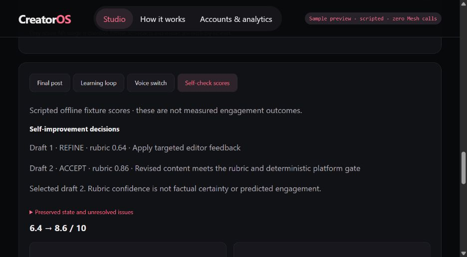

# Bounded outer self-improvement loop

The supplied diagram inspires control flow; this is a content-quality loop, not an
autonomous web-research agent. The existing performance-feedback loop still learns
separately from actual observations. All live AI remains behind the Mesh gateway.

Each writer/editor pass records the draft, slides, criterion scores, concrete
edits, issues, score change and preserved brief/voice/evidence references.
The coordinator then chooses:

- **REFINE:** apply editor feedback to the actual draft and slides. Even a strong
  first draft must undergo a changed revision.
- **ACCEPT:** in live mode a revised draft averages at least 9.1/10, has no criterion
  below 8/10, meets concrete platform checks, and introduces no new local-check
  regression. Independent source verification still must pass. Scripted offline
  routing demonstrations preserve their historical 8/10 and 6/10 fixture thresholds.
- **RESTART:** if the second draft stalls or regresses and has not passed, revisit
  the strategy once. The strategist receives the original brief, voice, evidence,
  last draft and critique. This consumes the remaining third draft slot; it never
  resets the budget or erases rejected work.
- **NEEDS_REVIEW:** stop after at most three drafts. Preserve the strongest revised
  candidate, withhold approval/scheduling, and skip visual/image generation.

An accept is not a claim of factual correctness. `confidence_score` is the editor
average divided by ten and is explicitly uncalibrated. It does not measure truth,
real audience response or probability of success. Content still needs human review.
There is no extra LLM confidence judge or automated broad research/citation fetching.

The current live success path includes an independent verifier in addition to
strategy, two writers, two editors, visual prompt and optional image: up to eight
calls. A third targeted editorial draft is permitted when capacity remains, with
one verifier call reserved. A restart or evidence retry can use that remaining
capacity instead; it does not create another budget. Images may be skipped and
unsupported drafts held if capacity runs out. The existing ten-call cap still
applies, including optional format repair calls. No paid validation was performed.

The agent log exposes every `improvement` decision. Self-check scores shows the
decision trajectory, selected version, score and preserved state. Older posts have
no fabricated assessments; regenerate only when paid generation is authorized.

## Reproduction and measured boundaries

`python -m unittest discover -s tests -v` passes 37 local tests. New cases cover
successful refinement without extra calls, one strategy restart followed by
recovery, exhaustion with no image spend, preserving a stronger earlier revision,
and preventing a high average from hiding a very weak criterion or length failure.

`python scripts/evaluate_improvement.py` reproduces four labeled scripted cases in
`evaluation-improvement.json`. These are routing measurements, not new AI quality
results. Existing historical real-output evaluation numbers remain unchanged.

