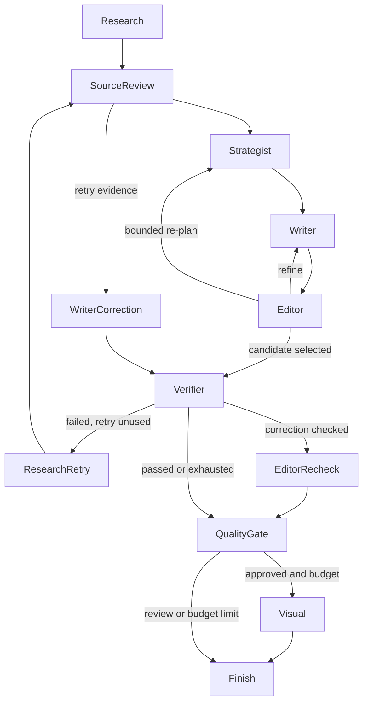

# Structured research, disagreements, source quality and reusable reports

## Executable agent framework

CreatorOS uses its own small compiled `StateGraph` framework in `agent_graph.py`,
with twelve explicit nodes, declared successor edges and a 48-step execution
ceiling. `pipeline_graph.py` supplies a real handler for each node. Unknown edges
fail, and a state transition cannot invoke a node absent from the definition.
The graph drives execution, not just a diagram. Its definition is exposed at
`GET /workflow/definition` and saved with each new post's actual `graph_trace`.

The initial research node invokes the actual retrieval callback in `main.py`.
Thin, unsupported or malformed verification results route back to the bounded
research callback once, then through source review, writer correction and an
independent re-check. An unconfigured callback is explicitly recorded as no
retrieval, rather than fabricated evidence. Failed final checks leave the post in
review. The existing ten-call default generation cap still applies; graph,
provenance and local conflict nodes themselves make no model calls. Visuals may
be skipped when verification consumes the remaining call budget.

## Contradiction detection

`source_policy.py` groups explicit comparable numeric product statements by
entity/property and flags different values across sources. It does not compare
unrelated products or arbitrarily compare dates with prices. In addition, the
existing Mesh Verifier call is asked to identify semantic disagreements such as
negation, scope or conflicting instructions. Its `conflicts` output must contain
literal quotations from two distinct saved sources; unknown IDs and invented
quotations fail validation. This adds no separate source-judge call.

Disagreements retain both quotations, source IDs, a reason, detection method and
`unresolved` status. They appear in Final post, the audit export, follow-ups and
the standalone report. A source with the highest provenance score is labeled a
review preference, never an automatic resolution. Unqualified claims relying on
a detected dispute are withheld/marked thin. Explicit source attribution can
preserve what a particular document says while the conflicting evidence remains
visible. Attribution detection and local numeric matching are conservative
heuristics, not a general entailment proof; the semantic verifier may miss
conflicts and has not been live-evaluated in this change.

## Visible source-quality rules

The `QUALITY` table and `quality()` function in `source_policy.py` define all
weights. Source findings are ordered by these scores before agents receive
them; prompts also receive the score, scope and reason.

| Provenance | Weight | Scope / limitation |
|---|---:|---|
| Authenticated provider observation | 0.95 | That account/window only; not proof of product claims in a post |
| Configured official product page | 0.90 | Brand-supplied official URL; ownership/claims are not independently certified |
| Explicit primary source | 0.90 | Evidence still needs claim-level inspection |
| Owner-supplied product facts | 0.75 | Self-reported, not independent confirmation |
| Uploaded document | 0.65 | Recorded content/hash; authority is unverified |
| Supplied media notes/transcript | 0.55 | User text, not automatic audio/video observation |
| Third-party blog | 0.30 | Secondary commentary |
| Unknown provenance | 0.25 | No assumed authority |

Explicit `is_current=false` metadata reduces a weight by 0.25. Scores are policy
choices, not learned probabilities, reliability measurements or proof of truth.
The current retriever visits configured official product pages and saved brand
documents; the blog tier governs secondary sources if present, rather than
claiming that arbitrary blog search is enabled.

## Clean, shareable export

Saved posts offer **Open report page** and **Download shareable HTML**.
`GET /posts/{id}/report?download=true` returns a standalone `.html` file with
inline print styling, caption/slides, cited claims, source quotations, provenance
weights, unresolved disagreements, withheld findings and planning/scheduling
reasons. Browser Print can save it as a PDF; the application does not claim to
generate a separate PDF binary.

User/source text is HTML-escaped; the page has no external scripts, trackers or
remote assets. The server sets a restrictive Content Security Policy. API keys,
connector credentials and raw media binaries are not included. Source excerpts
and document titles are included, so share the file only with recipients who
should see that research. This is a local/downloadable export; no public hosting
or automatic external sharing is performed.

## Conversational follow-up

Under Final post, **Continue with this research** offers:

- Saved evidence and recorded-disagreement views: deterministic, zero AI calls.
- **Ask Mesh**: an answer-writing call and an independent Verifier call, with a
  hard two-call client ceiling including formatting retries. It uses
  `MESH_FOLLOWUP_MODEL` (default GPT-4.1 mini) and the existing verifier route.
  Global `MESH_ENABLE_PAID=1` is required; ordinary browsing stays available when
  spending is locked. No source evidence means no AI call.

The context contains up to eight sources from the earlier saved research, with
relevance selection and complete conflict groups, plus the last two completed
Mesh conversation turns. Source groups that cannot fit are omitted together and
their IDs are disclosed. Previous chat provides intent, not new factual evidence.
No follow-up triggers a fresh website, social-provider or document ingestion.

Each turn stores its exact source snapshot/hash, question, mode, verdicts,
citations and call count. The original post is preserved. A failed verifier
withholds the draft answer and returns a review message; no additional correction
loop spends credits automatically. Request IDs are reserved in a SQLite
transaction before calls, so resubmitting the same request cannot generate again.
Interrupted turns are marked failed on restart and require an explicit retry.

Routes: `GET/POST /posts/{id}/followups`.

## Local measurements

Tests cover execution of the verifier → research retry → correction → verifier
edges, node/edge validation and cycle limits, primary-vs-blog ordering, quoted
contradictions, real conflicted-claim correction, export escaping/security headers,
source-group selection, post isolation, conversation reuse, idempotency, paid locks
and the two-call ceiling. Model responses are mocked; no live Mesh, provider or
publishing calls were made.

On the unchanged authored stress benchmark, the added numeric-conflict guard
withholds one additional unsupported stale-spec assertion: grounded claims
increase from **10/17 (58.8%) to 10/16 (62.5%)**, while required-fact completeness
remains **10/18 (55.6%)**. Five unsupported assertions and one incompletely cited
multi-source assertion remain in the adversarial fixtures. These are controlled
filter results, not live model-quality scores. The previous result is preserved
in `docs/evaluation-history/receipt-filter-v1.json`; current results and updated
code fingerprints are in `docs/evaluation-grounding.json`.

Final local validation on 20 October 2026: **109/109 repository tests passed**. The recorded benchmark reproduced exactly. Python compilation, JavaScript syntax and whitespace checks passed. Validation used **0 live AI calls and $0 Mesh spend**. Live semantic-conflict and conversational-answer quality remain unmeasured.

Verifier prompt compaction removes duplicate research findings, voice and prior chat from the verification request while preserving exact source excerpts, citations, scope and conflicts. The writer and verifier still receive the evidence they need; repeated metadata does not add another model call.
