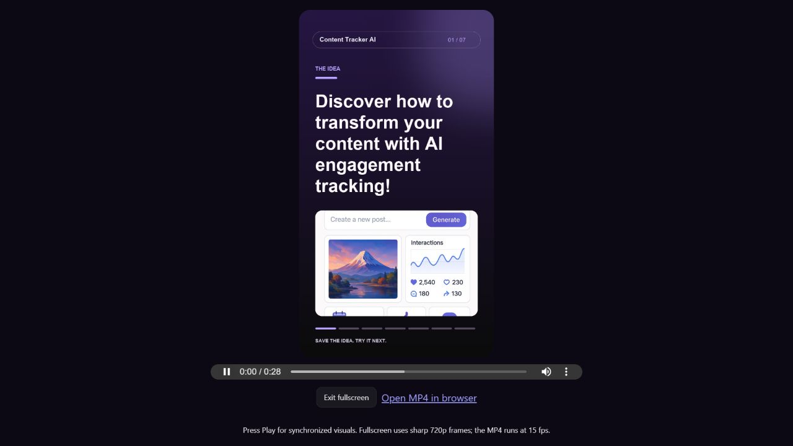
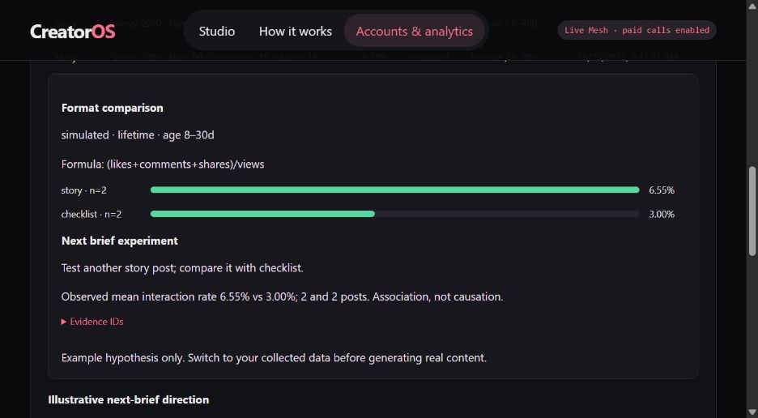

# Local validation — 20 October 2026

No paid Mesh inference or live social-provider requests were made for this work.

- `python -m unittest discover -s tests -v`: 33 tests passed. HTTP/SDK responses
  are mocked; temporary databases isolate tests from saved content.
- The analytics regression follows collected observations through a saved,
  account-specific learning rule into the next coordinator/strategist run using
  the explicitly labeled offline gateway. This proves wiring, not AI quality.
- JavaScript syntax checks passed for `static/studio.js` and `static/social-ui.js`.
- The browser displayed all six fictional platform reports, their provenance,
  native counters, comparison formulas and suggested experiments. Examples never
  enter production learning. No accounts are authorized by these checks.
- An existing approved post and its saved image were reused to render a 28-second
  720×1280 MP4 with original synthesized music, crossfades and 84 sharp preview
  frames. Actual browser playback reached `readyState=4`, advancing time, and
  fullscreen displayed the frame. The in-app preview is 3 fps; MP4 export is 15 fps.
- Optional paid Mesh video and speech paths are contract-tested and remain
  separately locked. Their live model compatibility and media quality are untested.
- Existing historical content-quality results remain unchanged. No engagement
  uplift, highest-quality ranking or lowest-cost claim is established.

Reproduce tests after installing `requirements.txt`; use `requirements-dev.txt`
for the optional offline token benchmark. Runtime examples and local exports need
no additional Mesh credits. Live account validation requires provider credentials,
permissions and user authorization. This server is local and single-user.

